# ELEC 4 – Python Programming

**Name:** Samantha Ondoy
**Section:** IV-BSIT-A
**Course:** ELEC 4 – Python Programming
**Instructor:** Carl Gustaf Patrik B. Ferrer

Beginner-friendly Python programs for Set 1 (P1–P4) and Set 2 (P5–P8). Each program runs in a terminal and prints "Prepared by: Samantha Ondoy (IV-BSIT-A)".

## Activities

| Set | Activity | Description | Folder |
|---|---|---|---|
| 1 | P1 · Student Grade Calculator | Menu-driven calculator for average, highest, lowest, and pass/fail grades, with input validation. | [set1/p1](set1/p1/) |
| 1 | P2 · Custom Module | `student_utils.py` module used by `p2_main.py` through both import styles, plus `datetime`. | [set1/p2](set1/p2/) |
| 1 | P3 · Student Record Manager | Add, remove, search, and display names using a list and a set, with case-insensitive duplicate checks. | [set1/p3](set1/p3/) |
| 1 | P4 · Safe Menu Program | Division and file reading with try/except/else/finally for ValueError, ZeroDivisionError, and FileNotFoundError. | [set1/p4](set1/p4/) |
| 2 | P5 · Student Information File System | Add, display, search, and update student records saved permanently in `students.txt`. | [set2/p5](set2/p5/) |
| 2 | P6 · Recursion Toolkit | Recursive factorial, Fibonacci, sum 1..n, and list search. | [set2/p6](set2/p6/) |
| 2 | P7 · Student Management System with Classes | Student, Subject, and Section classes with a private, validated grade. | [set2/p7](set2/p7/) |
| 2 | P8 · Inheritance and Polymorphism | Person parent class with Student and Teacher children that override `introduce()`. | [set2/p8](set2/p8/) |

## Requirements

- Python 3, no extra packages
- Run each command from the `ELEC4-Python-Ondoy` folder (on Windows, use `py -3` instead of `python3`)

---

# Set 1

## P1 · Student Grade Calculator

```bash
cd set1/p1
python3 p1_grade_calculator.py
```


## P2 · Custom Module

```bash
cd set1/p2
python3 p2_main.py
```

Run it inside `p2` so Python can find `student_utils.py`.

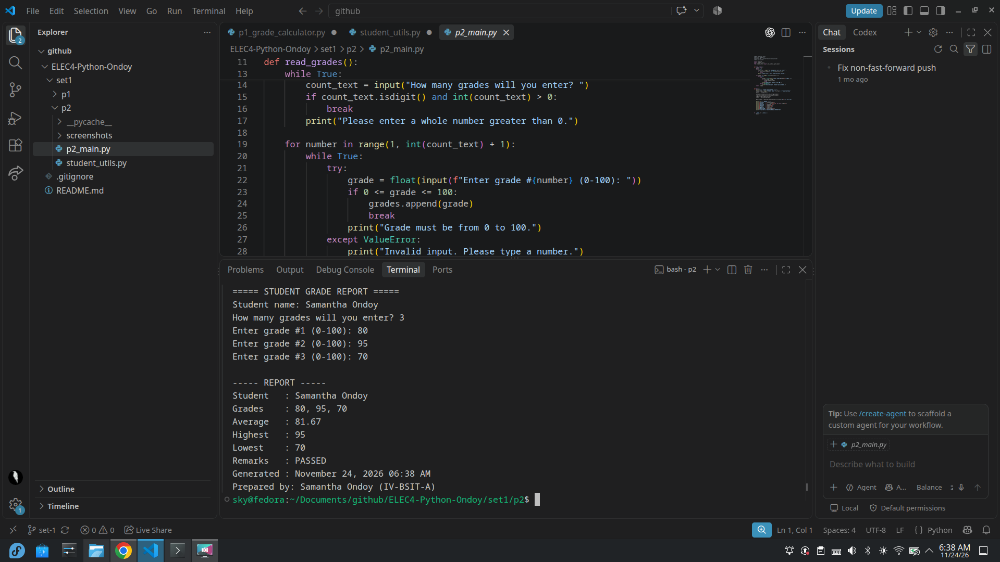

## P3 · Student Record Manager

```bash
cd set1/p3
python3 p3_record_manager.py
```

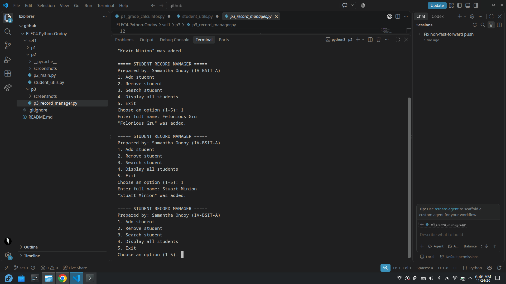
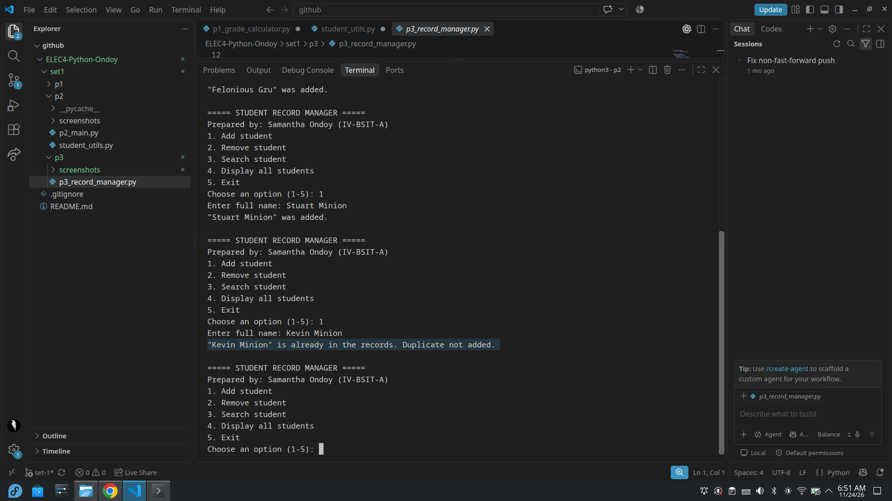
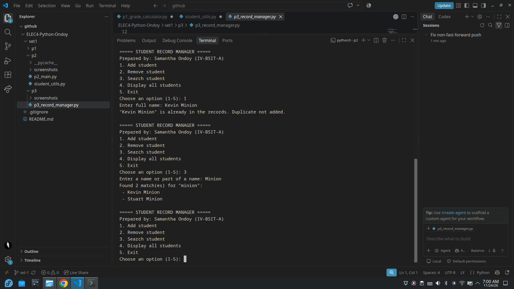


## P4 · Safe Menu Program

```bash
cd set1/p4
python3 p4_exceptions.py
```

Run it inside `p4` so `sample.txt` can be opened by name.


---

# Set 2

## P5 · Student Information File System

```bash
cd set2/p5
python3 p5_file_system.py
```

Records are saved in `students.txt`, so they stay after the program closes.

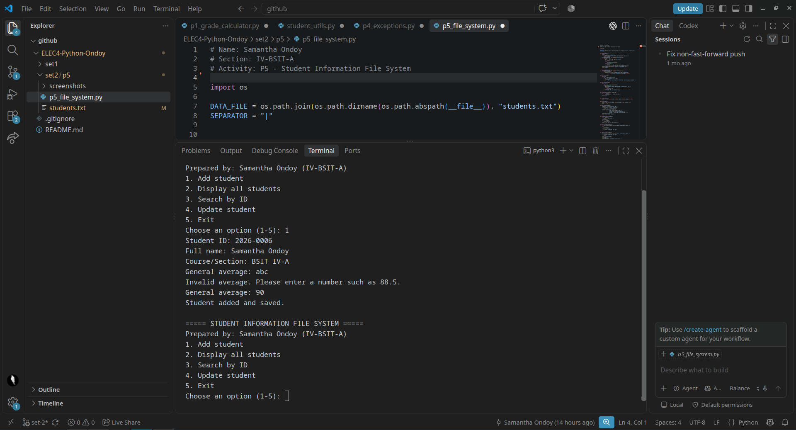
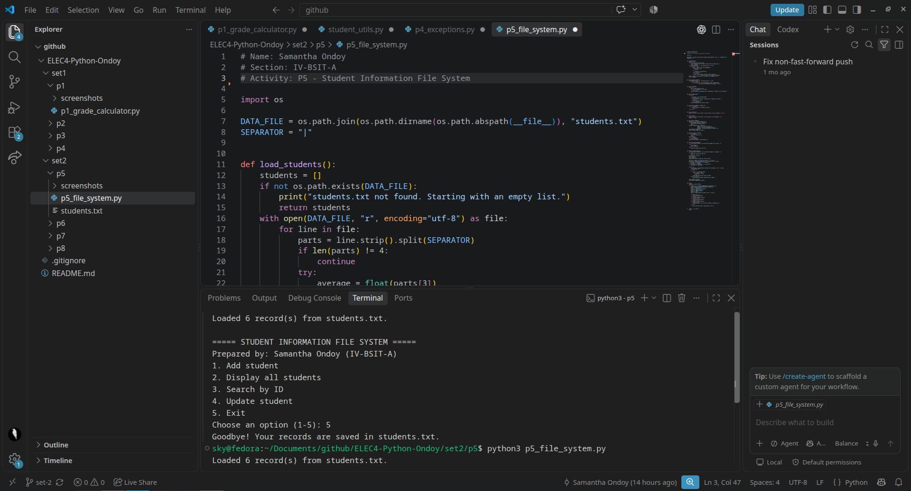
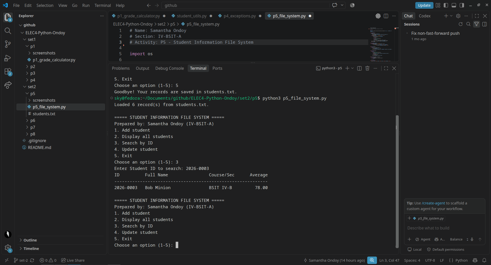
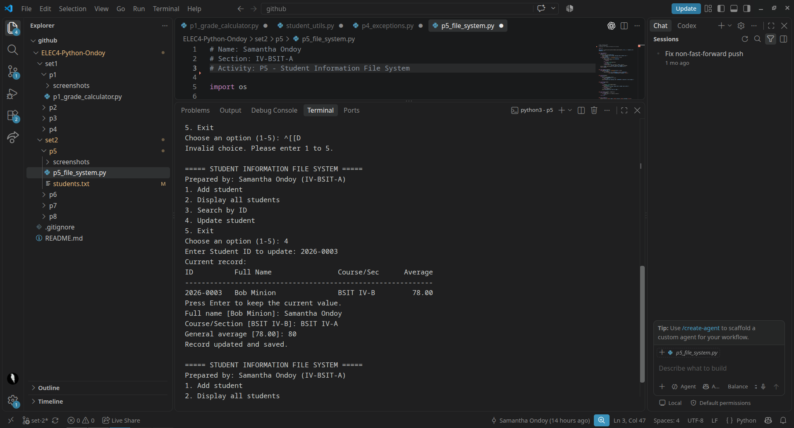

## P6 · Recursion Toolkit

```bash
cd set2/p6
python3 p6_recursion.py
```

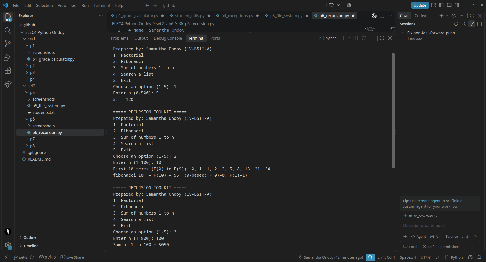

## P7 · Student Management System with Classes

```bash
cd set2/p7
python3 p7_classes.py
```

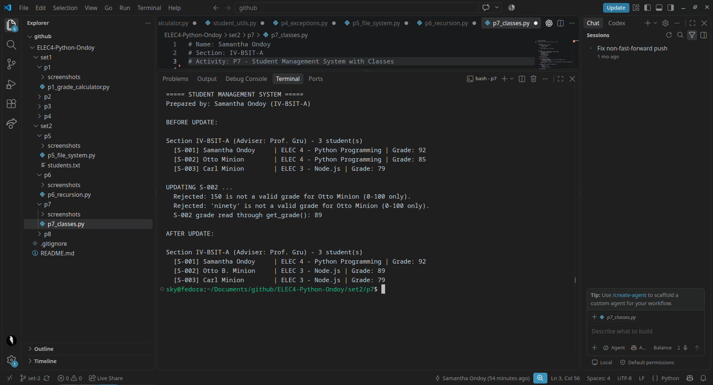

## P8 · Inheritance and Polymorphism

```bash
cd set2/p8
python3 p8_inheritance.py
```

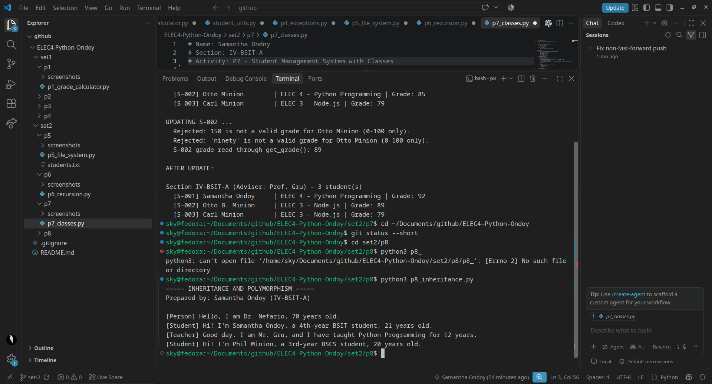
