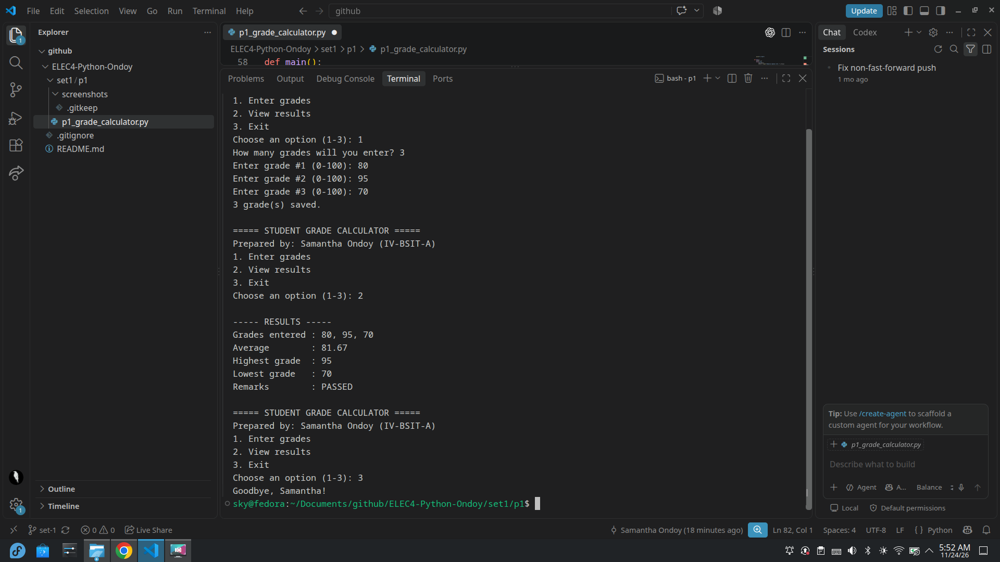
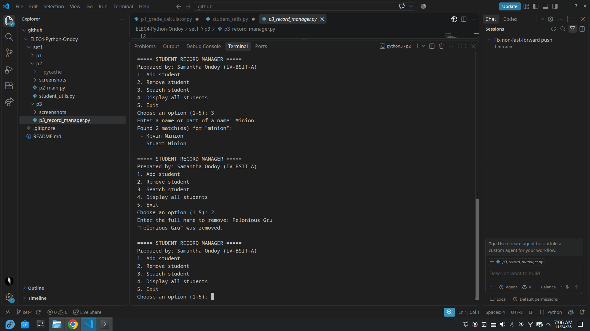
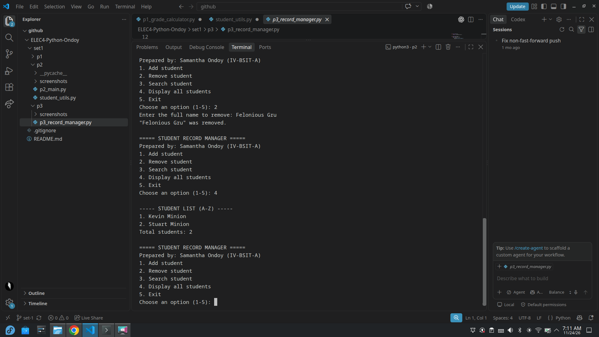
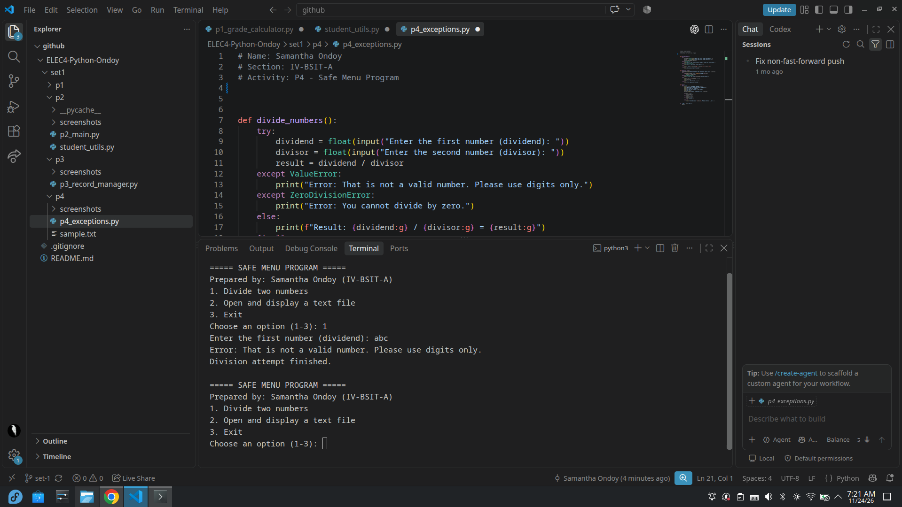
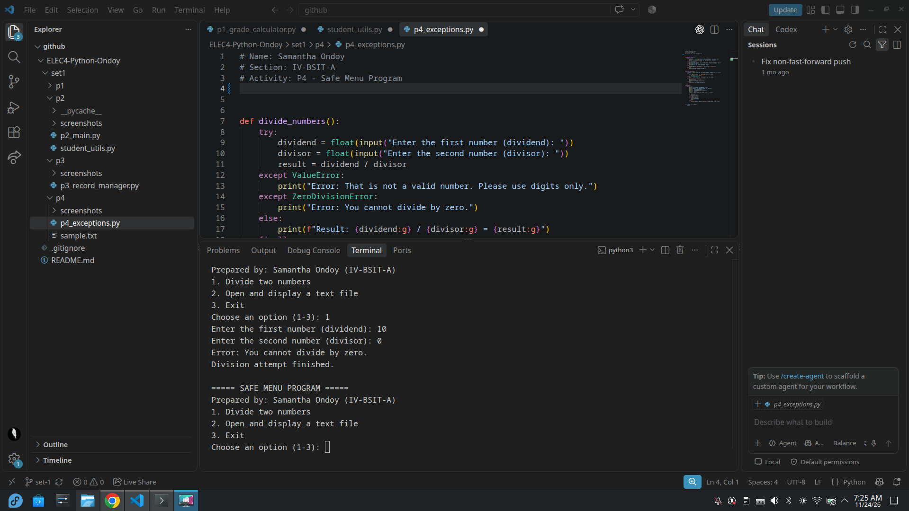
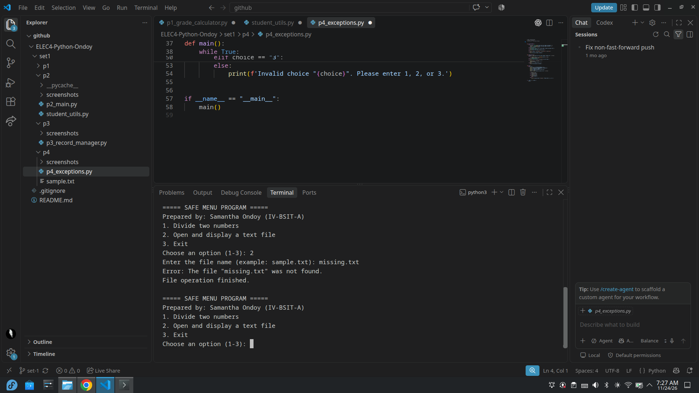
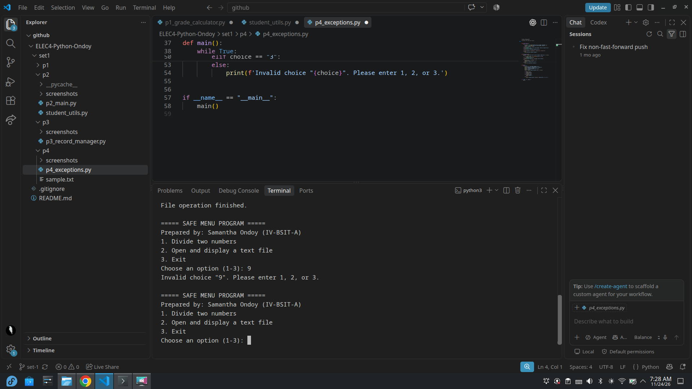

# ELEC 4 – Python Programming

**Name:** Samantha Ondoy
**Section:** IV-BSIT-A
**Course:** ELEC 4 – Python Programming
**Date:** 11-21-2026

Beginner-friendly Python programs for Set 1 (P1–P4). Each program runs in a terminal with Python 3 and needs no extra packages.

## Activities

| # | Activity | Folder | Description |
|---|---|---|---|
| P1 | Student Grade Calculator | [set1/p1](set1/p1/) | Menu-driven calculator for average, highest, lowest, and pass/fail grades, with input validation. |
| P2 | Custom Module | [set1/p2](set1/p2/) | `student_utils.py` module used by `p2_main.py` through both import styles, plus `datetime`. |
| P3 | Student Record Manager | [set1/p3](set1/p3/) | Add, remove, search, and display names using a list and a set, with case-insensitive duplicate checks. |
| P4 | Safe Menu Program | [set1/p4](set1/p4/) | Division and file reading with try/except/else/finally for ValueError, ZeroDivisionError, and FileNotFoundError. |

## How to run

Requires Python 3. Every command block starts in the `ELEC4-Python-Ondoy` folder.

```bash
# P1
cd set1/p1 && python3 p1_grade_calculator.py

# P2 (run inside p2 so Python can find student_utils.py)
cd set1/p2 && python3 p2_main.py

# P3
cd set1/p3 && python3 p3_record_manager.py

# P4 (run inside p4 so you can open sample.txt by name)
cd set1/p4 && python3 p4_exceptions.py
```

On Windows, use `python` (or `py`) instead of `python3` and backslashes in the paths.

## Screenshots

Every program prints **"Prepared by: Samantha Ondoy (IV-BSIT-A)"** in its menu or header.

### P1 — `set1/p1/screenshots/`
- `p1_results.png` — choose 1, enter grades (for example 80, 95, 70), then choose 2. The average, highest, lowest, and PASSED/FAILED must all be visible.



### P2 — `set1/p2/screenshots/`
- `p2_output.png` — the full report, including the "Generated" date and time.


### P3 — `set1/p3/screenshots/`
- `p3_add.png` — add `Kevin Minion`, `Felonious Gru`, and `Stuart Minion`.
- `p3_duplicate.png` — try to add `kevin minion` and show the "Duplicate not added" message.
- `p3_search.png` — search `minion` and show both Minion matches.
- `p3_remove.png` — remove `felonious gru`.
- `p3_display.png` — option 4 showing the numbered A–Z list and total.





### P4 — `set1/p4/screenshots/`
- `p4_invalid_number.png` — option 1, type `abc` as a number.
- `p4_zero_division.png` — option 1, divide `10` by `0`.
- `p4_missing_file.png` — option 2, type `missing.txt`.
- `p4_invalid_choice.png` — type `9` at the menu.





